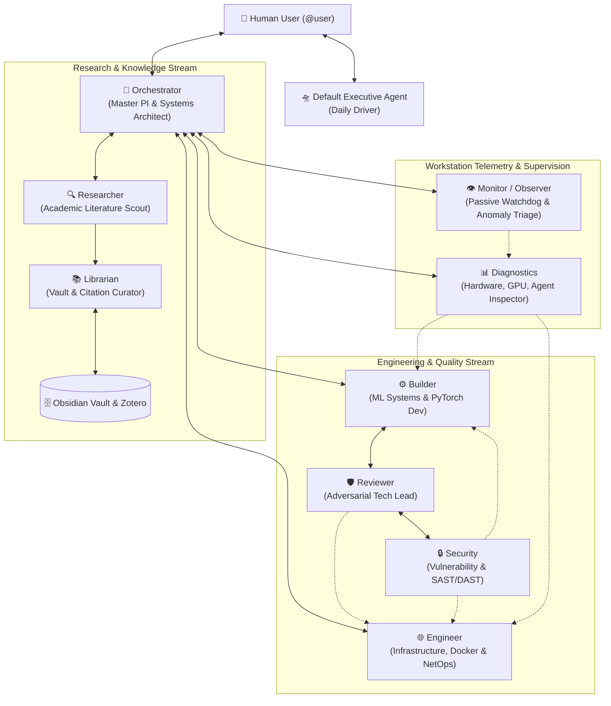

# 🤖 Hermes Agent Bot Mode Starter: 10-Specialist Multi-Agent Ecosystem

[](https://opensource.org/licenses/MIT)
[](https://github.com/NousResearch/hermes-agent)
[](https://github.com/NousResearch/hermes-agent)

A production-grade multi-agent Bot Mode starter for **[Hermes Agent](https://github.com/NousResearch/hermes-agent)**. Inspired by Callum's (Wanderloots) multi-agent research workflow, this repository moves beyond a single monolithic assistant into a specialized team of **10 dedicated agents**, complete with complementary tool whitelisting, group chat rooms, zero-token watchdogs, headless LibreOffice automation, native coding engine integrations (`codex`, `acpx`, `opencode`, `omp`), and autonomous deep research.

---

## 🏛️ Architecture: The Specialist Roster



### The 10 Specialized Bots

| Profile | CLI Command | Role & Scope | Scoped Toolsets | Key Boundaries |
| :--- | :--- | :--- | :--- | :--- |
| **`default`** | `hermes` | **Personal Executive & Daily Driver**<br/>General dialogue, quick tasks, personal assistant | Core standard toolbelt | Interactive daily driver. Respects rate-limits and fast turnarounds. |
| **`orchestrator`** | `orchestrator` | **Master PI & Systems Architect**<br/>Decomposer, task dispatcher, user gatekeeper | `delegation`, `todo`, `kanban`, `memory`, `file`, `terminal`, `skills` | Never codes directly. Manages high-level strategy and escalates to `@user`. |
| **`researcher`** | `researcher` | **Academic Literature Scout**<br/>Preprints, empirical metrics, deep research | `web`, `browser`, `file`, `skills` (`arxiv`, `open-deep-research`) | **Strictly read-only on code.** Ingests preprints into vault. Zero hallucinated citations. |
| **`builder`** | `builder` | **ML Systems & Implementation**<br/>PyTorch/CUDA models, unit testing, optimization | `terminal`, `file`, `code_execution`, `skills`, `context_engine`, `lsp` | Builds algorithms and verifies tensor shapes. Uses `codex`, `opencode`, `omp`, and `acpx`. |
| **`diagnostics`** | `diagnostics` | **Workstation Telemetry Auditor**<br/>GPU thermals/VRAM, coding agent inspector | `terminal`, `file`, `skills` (`system-tune`, `agent-status`, `token-projection`) | Zero-token automation. Audits hardware and active agents. Never kills processes without consent. |
| **`engineer`** | `engineer` | **Systems Infrastructure & NetOps**<br/>Docker, Containerlab testbeds, MCP servers | `terminal`, `file`, `code_execution`, `connections`, `skills`, `lsp` | Manages container stacks, network emulation, and MCP servers. Binds strictly to `127.0.0.1`. |
| **`reviewer`** | `reviewer` | **Adversarial Code Reviewer**<br/>Skeptical tech lead, PR quality auditor, quality gates | `terminal`, `file`, `skills`, `context_engine`, `lsp` | **Audits diffs before merging.** Enforces 5 quality axes. Never rewrites code directly. |
| **`security`** | `security` | **Vulnerability Researcher & Security Analyst**<br/>SAST/DAST, dependency auditing, exploit assessment | `terminal`, `file`, `skills`, `connections`, `clarify`, `lsp` | **Defense-only.** Audits code for injection vectors, audits container and network isolation. |
| **`librarian`** | `librarian` | **Knowledge Vault Curator**<br/>Obsidian MOC indexing, Markdown hierarchy, Zotero | `file`, `skills` (`zotero-sync`, `git-guard`, `libreoffice-tools`) | **Vault and literature archivist.** Enforces 100% wikilink resolution, formats BibTeX. |
| **`monitor`** | `monitor` / `observer` | **Passive Watchdog & Workstation Observer**<br/>Anomaly detection, process health, log watcher | `terminal`, `file`, `skills`, `clarify` | **Passive observation only.** Flags anomalies. Never mutates codebase or state. |

---

## 🧠 Tiered Model Routing & Fallback Guarantees

1. **Work Bots (`builder`, `engineer`, `reviewer`, `security`)**:
   - **Primary Model**: `gpt-6.1-terra` on `medium` or `high` reasoning effort.
   - **Failover / Fallback**: Always degrades to `gemini-3.8-flash` (maintaining high effort) and `openrouter/free`.
2. **Conversational & Scoping Bots (`default`, `orchestrator`, `librarian`, `diagnostics`, `monitor`)**:
   - **Primary Model**: `gemini-3.8-flash` on `low` effort (`researcher` on `medium`).
   - **Failover / Fallback**: `gemini-3.5-flash` $\to$ `openrouter/free`.
3. **Advanced Model Tasks**:
   - Model: `gemini-3.1-pro` (explicitly skips experimental Argon and Carbon models for benchmark stability).
4. **Strict Negative Fallback Guarantee**:
   - **Never use GPT as a fallback.** Fallbacks must always degrade to weaker or equivalent models (`gemini-3.5-flash`, `openrouter/free`) to avoid unexpected billing or quota lockouts.
5. **Slow & Batch Tasks Tier**:
   - OpenRouter free models (`openrouter/free`, `google/gemma-4-31b-it:free`) reserved for unhurried, rate-paced background batch operations (scraping, indexing).

---

## 💻 Native Coding Engines & Protocol Integrations

Bots interface natively with external coding engines and language servers:

- **Codex CLI (`codex`) & OMH Runner**: Automated worktree execution with validation gates:
  ```bash
  omh coding run --owner codex --goal "<task>" --verification-command "pytest"
  # Or headless execution:
  codex exec "<task>" --json
  ```
- **OpenCode CLI (`opencode`)**: Deep repo analysis and multi-step bug fixing (`opencode run "<task>"`).
- **Pi / Oh My Prompt (`omp` / `pi`)**: Scratchpad coding, Python runner, and notebook editing (`omp --smol` / `omp --slow`).
- **Agent Client Protocol (`acpx`)**: Headless agent delegation (`acpx codex "<task>" --approve-all`, `acpx opencode "<task>" --approve-all`).
- **LSP Code Intelligence**: Oh My Hermes integration (`plugins.entries.omh.settings.lsp_tools: true`) providing `lsp_definition`, `lsp_references`, `lsp_diagnostics`, and `lsp_rename`.

---

## 👥 Multi-Agent Group Chat Rooms

1. **`research-council` (Research & Literature Council)**:
   - **Members**: `@orchestrator` + `@researcher` + `@librarian`
   - **Workflow**: `@researcher` gathers ArXiv preprints $\to$ `@orchestrator` evaluates methodology $\to$ `@librarian` publishes structured reviews with verified BibTeX into Obsidian.
2. **`ml-systems-lab` (ML Systems & Verification Lab)**:
   - **Members**: `@orchestrator` + `@builder` + `@reviewer` + `@diagnostics`
   - **Workflow**: `@orchestrator` specifies model architecture $\to$ `@builder` implements PyTorch layers and runs tests $\to$ `@diagnostics` tracks VRAM headroom $\to$ `@reviewer` stress-tests edge cases.
3. **`systems-netops` (Infrastructure & NetOps Swarm)**:
   - **Members**: `@orchestrator` + `@engineer` + `@diagnostics` + `@reviewer`
   - **Workflow**: `@engineer` builds Docker/network setups $\to$ `@diagnostics` monitors host telemetry $\to$ `@reviewer` audits container security.
4. **`software-engineering` (Software Engineering Suite)**:
   - **Members**: `@orchestrator` + `@builder` + `@engineer` + `@reviewer`
   - **Workflow**: Multi-agent software design, end-to-end implementation, container integration, and adversarial code review.
5. **`security-research` (Security & Red-Team Research Lab)**:
   - **Members**: `@orchestrator` + `@security` + `@reviewer` + `@engineer`
   - **Workflow**: SAST/DAST static analysis, dependency vulnerability triage, container hardening, and adversarial attack vector auditing.
   - **Workflow**: `@engineer` builds Docker/Containerlab setups $\to$ `@diagnostics` monitors host telemetry $\to$ `@reviewer` audits container security.

---

## 🛠️ Zero-Token & Automation Tools Included

- **`deep-research`** (`open_deep_research.py`): Multi-step literature retrieval across ArXiv, DuckDuckGo, and local Zotero.
- **`doc-convert` / `doc-inspect`** (`libreoffice_tools.py`): Headless LibreOffice 26.8 document conversion (DOCX/PPTX/XLSX/PDF/Markdown).
- **`system-tune`** (`system_diagnose.py`): Hardware telemetry, GPU thermals/VRAM, and memory compaction (`SIGUSR1`).
- **`agent-status`** (`agent_inspector.py`): Process inspector for active Claude Code, Vibe, Hermes, and Antigravity agents.
- **`git-guard`** (`git_workspace_guard.py`): Fast pre-EOD git integrity checker with automated emergency diff backups.
- **`token-projection`** (`project_token_usage.py`): Cumulative token spend, prompt caching ratios, and projected monthly inference costs.
- **`research-classify`** (`research_classifier.py`): Scans repositories and catalogs projects into Research vs. Engineering/Tooling.

---

## 🚀 Quick Start

### 1. Clone & Install
```bash
git clone https://github.com/rafifmalikdzaki/hermes-agent-bot-mode-starter.git
cd hermes-agent-bot-mode-starter
chmod +x install.sh
./install.sh
```

### 2. Configure Environment
```bash
cp .env.example ~/.hermes/.env
# Add your preferred API keys (Gemini, OpenRouter, Anthropic, or local Ollama)
```

### 3. Verify Profiles & Launch
```bash
# Verify all 7 specialist bots:
hermes profile list

# Launch interactive CLI chat with any specialist:
orchestrator chat
researcher -q "What are the latest breakthroughs in Kolmogorov-Arnold Networks?"
diagnostics chat

# Or launch the full Desktop GUI with Bot Mode:
hermes desktop
```

---

## 📄 License
MIT License. Created for the open-source agentic computing community.
